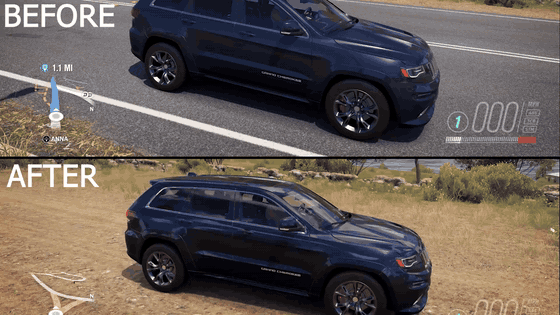

# Forza Horizon 3 - Extra Options (Azimuth)

An unofficial port of [Forza Horizon 2 Extra Options](https://github.com/RokkuDayo/ForzaHorizon2_ExtraOptions)
by Arthur (RokkuDayo) to the **Xbox One version of Forza Horizon 3**, running on the Azimuth
translation layer.



*`BlurRimThreshold`: the stock game swaps the spinning 3D rim for a flat blurred mesh (top);
with the mod the real rim keeps spinning (bottom).*

The same `winmm.dll` serves both games. When Azimuth loads Forza Horizon 2, the original
FH2 Extra Options 0.4.4 runs unchanged. When it loads Forza Horizon 3, a separate FH3
profile takes over with its own settings file and log. FH2 code is never entered for FH3.

> **WARNING (from the original project):** there is **NO** "All-In-One" installer, and
> anything that asks you to paste commands into PowerShell is a **scam**. Only download
> releases from this repository or from the original FH2 repository.

## Features

| Setting (`FH3_ExtraOptions.ini`) | What it does | Patches | Tested in-game |
|---|---|---|---|
| `[Frontend] SkipIntro` | Skips the developer and publisher opening videos | 4 | Yes |
| `[Content] OfflineVIP` | VIP status: VIP wheelspins, VIP rewards and the profile VIP flag | 5 | Yes |
| `[Content] UnlockTreasureMap` | Treasure Map for the mainland, Blizzard Mountain and Hot Wheels | 5 | Not yet |
| `[Content] UnlockDLC` | Every car pack, Car Pass car and both expansions | 1 | Not yet |
| `[Graphics] SmoothSunShadows` | Smooth, real-time sun shadows: all four cascades refresh every frame | 6 | Yes |
| `[Graphics] BlurRimThreshold` | Wheel speed at which the 3D rim is swapped for the flat blurred rim | 2 | Yes |
| `[HUD] MinimapFollowsCamera` | A rotating minimap turns with the camera instead of the car (FH2 feature) | 3 | Yes |
| `[Vehicle] HeadlightToggle` | Headlights on/off on every car with a controller button, left stick by default (FH2 feature) | 1 | Yes |
| `[Radio] LocalMusicRadio` | Brings back the Groove (Xbox Music) radio station, playing your own music files | 18 | Partly |
| `[Compatibility] DisableAzimuthSaveChecksums` | Same as FH2: bypass Azimuth's save size/hash rejection (off by default) | - | - |

Notes:

- **UnlockDLC.** Build 1.0.125.0 already ships every car pack and both expansions in its base
  media and database. Only `ContentOffers` ownership gates them: the game resets every offer
  with `UPDATE ContentOffers SET IsPurchased=0` at startup. This statement becomes `=1`, the
  same approach as FH2's `catalog_purchased`. It also marks the VIP, Treasure Map, horn and
  token offers as purchased.
- **SmoothSunShadows** costs GPU time. It renders four shadow cascades per frame instead of
  roughly one. FH3 adds a staggered mode that FH2 does not have, with the schedule
  `1,0,2,0,1,0,3,0,...`, so the far cascade updates only every 16th frame. This feature
  disables that mode as well. It is the FH3 version of FH2's real-time shadows option.
- **BlurRimThreshold** is a percentage of the game's blur `MaxRPM` (350). `50` is the game
  default, about 15 mph. Any value above `100` (default `200`) never swaps, so the real 3D
  rim always spins. The stock swap is instant because `GeomBlendStart` equals
  `GeomBlendEnd` (0.5) in `GlobalCarAttributes.xml`, and no car shader reads
  `g_BlurRimGeomBlend`, so the game cannot cross-fade the two meshes. At very high speed a
  real rim can show the wagon-wheel effect; `BlurRimThreshold=90` swaps late instead.
- **HeadlightToggle** works like FH2's vehicle lights: the player's car is the `ForzaCar` whose
  driver is the local `CPlayer`, and the button is read from the game's own controller state
  (any pad the game sees works). `HeadlightButton` is an XInput-style mask: `64` = left
  stick, `128` = right stick. The left stick is the horn by default, so move the horn in the
  game's controller settings first. Lights stay as you set them until you change car. Some
  cars also light cockpit elements together with the headlights, as they do at night.
- **MinimapFollowsCamera** only changes a minimap that rotates. It uses the camera of the
  active view, so looking around with the orbit camera turns the map.
- **LocalMusicRadio.** The Groove station talked to the Forza web service
  `Forza.WebServices.XboxMusic`, which no longer exists. The mod answers those calls itself:
  - the subscription check succeeds;
  - playlists and songs come from the music folder: `FH3_Music` next to the INI, or the
    `MusicFolder` setting. Every top-level subfolder is a playlist, plus "All music";
  - every song plays straight from its file through Windows Media Foundation (mp3, m4a, aac,
    wma, wav, flac);
  - a file named `Artist - Title.mp3` shows its artist and title, otherwise the folder name
    is shown as the artist.

  Turn the station on in **Settings > Audio** and pick a playlist there. The game itself
  unlocks the "Xbox Music" station during the story, with its Groove introduction popup;
  after that it appears in the radio list. Songs added while the game runs are found after a
  restart. `GrooveLog=1` writes the station's requests and state to the log. The settings
  page, playlists and subscription are tested; playback is not yet.

Everything else from FH2 Extra Options (garage from pause, autodrive, drift camera, FOV,
video menu, rims, mod loader and so on) is **not** ported to FH3. FH3 already lets you change
car anywhere from the pause menu (My Cars, with car delivery). The original feature list is
kept in [docs/FH2_README.md](docs/FH2_README.md).

## Requirements

- Azimuth 1.0.1, 1.0.2, 1.0.3 or 1.0.4 (the same builds the FH2 mod supports).
- Forza Horizon 3 for Xbox One, executable version **1.0.125.0** (title ID `4CE1DFAB`):
  `forza_durango_release_final.exe`, 85,425,664 bytes, SHA-256
  `e6a362a2fde118577ab3018c8e042e62a3bb42f83a63ace41145c0864527a661`.

Any other executable is refused and nothing is patched.

## Installation

1. Download `FH3_ExtraOptions_Azimuth.zip` from [Releases](../../releases).
2. Close Azimuth.
3. **Back up your saves:** `<Azimuth folder>\data\titles\4CE1DFAB\saves`.
4. Extract `winmm.dll`, `FH3_ExtraOptions.ini` and the `FH3_Music` folder into the Azimuth
   folder, next to `azimuth.exe`, replacing existing files.
5. Put your music into `FH3_Music`.
6. Start Forza Horizon 3 through Azimuth.

`FH3_ExtraOptions.log` appears next to the DLL. A successful start lists 45
`FH3: patched ...` lines and `OK: requested FH3 tweaks applied in memory.`

If you turn `UnlockDLC` off after using DLC cars, those cars may stay in or vanish from your
garage. Keep the save backup.

Uninstall: delete `FH3_ExtraOptions.ini` and `FH3_ExtraOptions.log`, then restore your
previous `winmm.dll`, or delete it if you use no other mods.

## How it works

- Nothing on disk is modified. Azimuth hands the mapped game image to the DLL before the game
  starts, and the FH3 profile patches code and data **in memory**.
- The executable is checked by size, SHA-256, PE timestamp and image size before any write.
- Every requested patch site is compared with its expected original bytes first. If any site
  differs, **no byte is changed**.
- Patch sites were found statically. Each FH2 Extra Options patch was matched to the equivalent
  FH3 code through shared strings, config-flag offsets, MSVC RTTI vtables (for example
  `ShadowMapRendererAnthem11`) and identical instruction shapes. The game database and shaders
  were inspected for the DLC and wheel features.
- Hooks into the DLL use a vtable slot (headlights) or a call/jump redirected to a
  `jmp [rip]` thunk written into unused `int3` padding (minimap, radio). The DLL pins itself
  before any of them is written.

The full patch table, with the reasoning for every site, lives in
[features/fh3.c](features/fh3.c). The hooked features have their own files:
[fh3_lights.c](features/fh3_lights.c), [fh3_minimap.c](features/fh3_minimap.c) and
[fh3_groove.c](features/fh3_groove.c).

| Group | Sites (RVA) |
|---|---|
| Intro | `0x1724ab6`, `0x17265f0`, `0x1727e32`, `0x1729558` (FH2 `+0x319b` / FH3 `+0x32d8` skip-intro flag) |
| VIP | `0x3499e5`, `0x33c91e`, `0x3c5b74`, `0x992770`, `0x9826c8` (`Main/IsVip` readers) |
| Treasure Map | getters `0x1071870`, `0x10713f0`, `0x1071450`; direct readers `0x4a53c4`, `0x151f3f5` |
| DLC | `0x2d30565` (`IsPurchased=0` becomes `=1`) |
| Sun shadows | `0x1b7d459`, `0x1b82711`, `0x1b82dcd` (FH2 equivalents); `0x1b80a50`, `0x1b80a58`, `0x1b7d4a6` (FH3 staggered mode) |
| Blur rims | `0x1e37b6d` (threshold load), `0x1e37c8c` (threshold value in padding) |
| Headlights | `ForzaCar` vtable slot 16 `0x42e06d0` (per-car update) |
| Minimap | call `0x120b3d2` (tracking minimap update), thunk `0x2603260` |
| Radio | 9 XboxMusic service calls `0x27b84c8`...`0x27b99c0`, song reader `0x1991dab`, player update jumps `0x1731b26`/`0x1731b39`; thunks `0x2700580`, `0x270bb80`, `0x260c610` |

## Building

Requires Python 3.10+ and Zig 0.15.2 (see [BUILD.md](BUILD.md)):

```text
python build.py /path/to/zig.exe
```

The output is the Azimuth `winmm.dll` with both the FH2 mod and the FH3 profile.

To re-check every FH3 patch site and every game structure the hooks rely on against your own
copy of the executable (needs `pefile` and `capstone`):

```text
set FH3_EXE=X:\path\to\Forza Horizon 3\Mount\forza_durango_release_final.exe
python tools/fh3_port/check_fh3_patches.py
```

`tools/fh3_port/` also contains the small helpers used during the port:

- `xbox_image.py` - PE and xref helpers;
- `rtti.py` - MSVC RTTI vtable lookup.

## Changes to the FH2 code

FH2 behaviour is unchanged: the code path for title `1A96545B` is the same as in FH2 Extra
Options 0.4.4. Changes to existing FH2 files:

- `adapters/azimuth.c`: accepts title `4CE1DFAB` and routes it to `fh3_initialize`.
- `adapters/azimuth_save.c`, `adapters/azimuth_markers.c`, `adapters/azimuth_host.h`: save
  compatibility and marker repair take a title ID; FH2 keeps calling them with `1A96545B`.
- `logging.c/.h`: `log_set_file` lets the FH3 profile write its own log.
- `kernel32.def`: imports `GetPrivateProfileIntW`.
- `build.py`: compiles the FH3 files and builds only the Azimuth `winmm.dll`.

Removed from this repository because the Azimuth build does not use them: the Mezcal
(`xg.dll`) adapter, the unfinished FM5 profile hooks, the unused Azimuth livery module, the
example plugins and the FH2 modding tools (`mod_diff.py`, the addon JSON generator and the
plugin/mod documentation). They remain available in the original FH2 repository. The FH2 mod
loader, addons and plugin loader themselves are still part of the DLL.

## Credits and license

- **Forza Horizon 2 Extra Options**: Arthur (RokkuDayo),
  <https://github.com/RokkuDayo/ForzaHorizon2_ExtraOptions>. All FH2 features, the DLL
  architecture, the Azimuth adapter and the patch engine come from that project.
- **Forza Horizon 3 port**: alezwork, November 2026. This is a modified version of the original
  work: the FH3 profile was added, the files listed above were changed and the unused files
  listed above were removed.
- The FH3 reverse engineering and code were done with the help of Claude (Anthropic), in the
  same spirit as the original project's AI usage disclosure.

Licensed under the GNU General Public License v3.0, the same as the original. See
[LICENSE](LICENSE).

This project is not affiliated with Microsoft, Playground Games, Turn 10 Studios or the
Azimuth authors. Forza Horizon is a trademark of Microsoft. Groove and Xbox Music are
trademarks of Microsoft.
